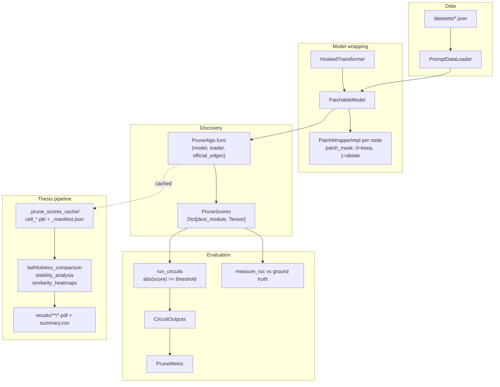
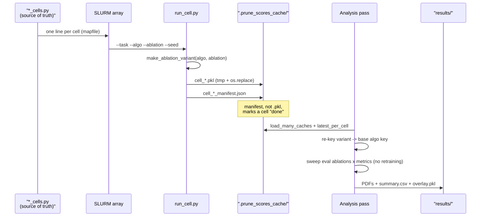

# Codebase Map

> Auto-generated by Cartographer. Last mapped: 2026-08-19T21:42:42Z

Fork of [UFO-101/auto-circuit](https://github.com/UFO-101/auto-circuit) extended for a master's thesis: porting **Edge Pruning** (Bhaskar et al. 2024) and **DiscoGP** (Yu et al. 2025) into AutoCircuit's standardized evaluation harness, then comparing them against ACDC/EAP under a controlled `(discovery-ablation, eval-ablation, patch-direction)` protocol triple.

Three layers, and the boundary between them is the thing to keep straight:

| Layer | Path | What it is |
|---|---|---|
| **Library** | `auto_circuit/` | Model wrapping, edge patching, algorithms, metrics. Mostly upstream + two ported algorithms. |
| **Experiments** | `experiments/`, `hpo/` | Thesis-specific drivers: cell runners, analysis passes, port-fidelity study, HPO. |
| **Write-up** | `thesis-overleaf/`, `thesis_notes/` | Not code. Separate git history (Overleaf clone), gitignored. |

## System Overview



The load-bearing idea: **every algorithm shares one signature**, `func(model, dataloader, official_edges) -> PruneScores`. That is what makes them swappable, and what lets the thesis bind a discovery ablation onto any of them via `make_ablation_variant`.

## Directory Structure

```
auto_circuit/                     # the library
  types.py                        # Edge, Node, PruneScores, AblationType, PatchType  (import root)
  data.py                         # PromptDataLoader, load_datasets_from_json, KV-cache prefix
  tasks.py                        # Task registry + MODEL_CACHE/DATASET_CACHE
  prune.py                        # run_circuits: PruneScores -> CircuitOutputs
  experiment_utils.py             # load_tl_model, IOI logit-diff helper
  visualize.py                    # circuit graph rendering
  visualize_circuit_slider.py     # interactive Sankey w/ edge-count slider
  prune_algos/                    # discovery algorithms (see Module Guide)
  metrics/                        # evaluation (prune_metrics, official_circuits, completeness)
  utils/                          # graph_utils, patch_wrapper, patchable_model, ablation_activations,
                                  #   tensor_ops, l0_utils (EP), gumbel_sigmoid_utils (DiscoGP), plot_theme
  model_utils/                    # per-architecture node builders (TL, micro, tracr, SAE, projector)
experiments/                      # thesis drivers
  run_cell.py                     # ONE (task, algo, ablation, seed) discovery cell -> cached PruneScores
  faithfulness_cells.py           # the 42-cell manifest (single source of truth)
  faithfulness_comparison.py      # Pillar 1 analysis pass
  stability_*.py                  # Pillar 2 (seed stability)
  similarity_heatmaps.py          # cross-cell Jaccard heatmaps
  port_comparison/                # port-fidelity study (EP + DiscoGP vs reference repos)
  demos/                          # minimal upstream examples: fastest way to learn the API
  ioi/ docstring/ sports_players/ # legacy upstream per-task experiments
hpo/                              # nested-CV hyperparameter search (Optuna)
tests/                            # pytest; slow tests gated behind --runslow
datasets/                         # prompt JSON + generators
third_party/{edge_pruning,disco_gp}/  # vendored reference implementations (gitignored)
docs/                             # this map, related_work/, port_validation/, superpowers/specs
*.sh                              # SLURM launchers (gitignored)
results/ .prune_scores_cache/     # outputs (gitignored)
```

## Core Concepts

Read this section before touching anything else; four conventions explain most of the code.

### 1. The mask convention (invert this and everything is silently wrong)

`patch_mask = 0.0` means **keep the original activation**. `patch_mask = 1.0` means **replace it with the ablation**. `PatchWrapperImpl.forward` computes:

```
arg_0 += mask * (patch_src_outs[in_srcs] - curr_src_outs[in_srcs])
```

so the mask interpolates from the live activation toward the ablation. Both reference repos (Edge Pruning, DiscoGP) use the opposite convention (`1 = keep`), which is why the ports carry deliberate sign flips: EP initializes `log_alpha` at `-10` where the reference uses `+10`, and DiscoGP stores `AC_mask = 1 - disco_mask`. `tests/prune_algos/test_disco_gp_components.py::test_mask_convention_inversion` pins this.

### 2. Patching cascades

`patch_mode` shares one `curr_src_outs` tensor across every wrapper. Each src wrapper writes its output into it as the forward pass proceeds; each dest wrapper reads from it. So an edge patched at layer 2 changes what layer 8's sources actually see. This is what makes edge patching correct, and it means wrapper execution order is not reorderable.

### 3. Scores are ranked by magnitude, and score semantics differ wildly per algorithm

`run_circuits` binarizes with `prune_scores.abs() >= threshold`. Every consumer takes `abs()`. But what the number *means* varies:

| Algorithm | Score semantics |
|---|---|
| EAP / mask_gradient | **signed** raw gradient (sign is meaningful: negative movers) |
| Edge Pruning | continuous soft mask `1 - sigma(log_alpha/T*F)` in (0,1) |
| DiscoGP | `sigmoid(edge_logit)` in (0,1) |
| ACDC | the smallest tau at which the edge was prunable, or `+inf` if never pruned |
| Circuit Probing | small-integer rank (smallest circuit containing the edge) |
| Ground Truth | binary {0, 1} |
| Random | uniform noise |

### 4. Determinism depends on canonical ordering

`model.edges` and `model.dest_wrappers` are Python **sets** (identity-hashed for modules), so iteration order varies **between processes**, not just runs. Anything that draws random numbers per-wrapper or builds an autograd graph in that order must use the sorted accessors: `model.ordered_dest_wrappers`, `model.patch_masks`, `model.new_prune_scores()`. `tests/utils/test_canonical_iteration_order.py` is the guard. This was a live bug: discovery was irreproducible from a fixed seed until 2026-08-01.

## Module Guide

### `types.py` — the import root

Everything imports from here; `PatchWrapper` exists as an ABC purely to break the `types.py` <-> `patch_wrapper.py` cycle.

- `Edge.patch_idx` encodes the ordering convention `[seq_idx] + [head_idx] + [src_idx - min_src_idx]`. Hand-built masks must replicate it exactly.
- `PatchType.EDGE_PATCH` patches edges **in** the circuit; `TREE_PATCH` patches everything **not** in it.
- `AblationType`: `ZERO`, `RESAMPLE`, `TOKENWISE_MEAN_{CLEAN,CORRUPT,CLEAN_AND_CORRUPT}`, `BATCH_TOKENWISE_MEAN`, `BATCH_ALL_TOK_MEAN`, with `.mean_over_dataset` / `.clean_dataset` / `.corrupt_dataset` predicates.
- `PruneScores = Dict[str, Tensor]` keyed by **dest module name**.
- **Side effect:** importing `types.py` mutates the global Plotly default template.

### `data.py` — datasets and the KV-cache prefix

`load_datasets_from_json` returns `(train_loader, test_loader)`. `PromptDataLoader` hardcodes `drop_last=True` (equal batch sizes are an invariant the KV cache and mean-ablation both rely on) and is always built with `shuffle=False`; the single shuffle happens once at load time under `random_seed`.

**`tail_divergence`** precomputes a KV cache for the shared prompt prefix. It only activates when *no* row is padded, otherwise `diverge_idx` stays 0 and the whole path is silently skipped. This was the subject of a real upstream bug (issue #17 / PR #18, fixed 2026-08-11): the cache was built from the first batch and reused across all later batches, worth up to 22.6 max-abs delta-logit on Greater-Than. **Any cached result predating 2026-08-11 is invalid.** `tests/test_tail_divergence_correctness.py` is the regression suite and encodes the numeric before/after evidence.

### `tasks.py` — task registry

`Task` is lazily initialized (`init_task()`), with process-global `MODEL_CACHE` (keyed by `(_model_def, dtype)`) and `DATASET_CACHE` (keyed including `seed`).

**The deepcopy is load-bearing.** `patchable_model()` mutates its input in place. `MODEL_CACHE` is keyed by model, not by task, so IOI and Greater-Than (both `gpt2-small`) share an entry; without `copy.deepcopy(model)` the second task double-wraps the first's `PatchWrapperImpl`. Guarded by `tests/test_seed_dataloaders.py::test_tasks_sharing_model_def_get_independent_models`.

Spine tasks share a data budget: `SPINE_BATCH_SIZE = 64`, `SPINE_BATCH_COUNT = (11, 4)` = 704 train / 256 test. Held identical across tasks because the algorithms consume the loader differently (ACDC reads only the first batch; EP's per-step signal is `batch_size`; DiscoGP's step count is `train_batches x epochs`). **Cache filenames do not encode the budget** — the cache directory is the only budget label, so never mix directories.

### `prune.py` — `run_circuits`

Sorts scores once (`desc_prune_scores`), then per (batch, edge_count) thresholds every dest mask and runs the model inside `patch_mode`.

**Ties:** the threshold is the k-th largest `|score|` and selection is `>=`, so a tie block straddling the boundary is admitted whole. Results are keyed by the **actual** pruned edge count, not the requested one — so requesting `[0, 5, 10]` can yield fewer than three distinct keys. This is why `EdgeCounts.GROUPS` exists (it picks boundaries at tie-group edges) and why ACDC needs `Budget(kind="threshold")` in analysis.

### `utils/graph_utils.py` — graph construction

`patchable_model(model, factorized, slice_output, seq_len, separate_qkv, kv_caches)` builds nodes/edges then injects wrappers **in place**.

- **factorized=True**: any earlier-layer src to any later-layer dest (residual-stream decomposition). This is what enables true edge patching. GPT-2 small: 157 srcs, 445 dests, **32491 edges**.
- **factorized=False**: adjacent layers only, i.e. node patching.
- **separate_qkv**: 3 dest nodes per head (`A{l}.{h}.{Q,K,V}`) vs one combined `hook_attn_in`. Must match `cfg.use_split_qkv_input` or factorized patching is silently wrong.
- **`patch_mode(model, src_outs, edges=...)`**: passing `edges` first zeroes **all** masks, then sets only the listed ones. Passing a partial edge set silently discards pre-set masks.

### `utils/ablation_activations.py`

Computes the `patch_src_outs` tensor per `AblationType`. `RESAMPLE` passes activations through unchanged (the ablation *is* the corrupt run); `ZERO` zeroes them; the `TOKENWISE_MEAN_*` family accumulates a mean across the whole dataloader (valid only because `drop_last=True` makes batches equal-sized). Asserts `src_idx` values form a contiguous `range(n)`.

### `prune_algos/` — the algorithms

`PruneAlgo` is a frozen dataclass whose **equality is by `key` alone**. `make_ablation_variant(base_algo, ablation_type)` partial-binds a discovery ablation onto an algo's `func` — this is the mechanism behind the thesis's discovery-ablation sweep. It works for EP/DiscoGP/ACDC/EAP; it raises `TypeError` at call time for Subnetwork/Circuit Probing, whose signatures have no `ablation_type` (they hardcode `TOKENWISE_MEAN_CORRUPT`).

| Algorithm | File | Default ablation | Mechanism |
|---|---|---|---|
| **Edge Pruning** (thesis) | `edge_pruning.py` | RESAMPLE | hard-concrete L0 + Lagrangian dual |
| **DiscoGP** (thesis) | `disco_gp.py` | **ZERO** | Gumbel-sigmoid + straight-through, 2 phases |
| ACDC | `ACDC.py` | RESAMPLE | greedy edge removal over a tau sweep |
| EAP | `mask_gradient.py` | RESAMPLE | one backward pass, signed gradients |
| Subnetwork/Circuit Probing | `subnetwork_probing.py`, `circuit_probing.py` | hardcoded MEAN_CORRUPT | mask optimization |
| Ground Truth / Random | `ground_truth.py`, `random_edges.py` | n/a | anchors |

**`edge_pruning.py`** — hard-concrete masks over `log_alpha`, sparsity controlled by dual ascent on Lagrange multipliers (`maximize=True` param groups). Registered hyperparameters match the paper's IOI sweep: all LRs 0.8, 3000 steps, 200 warmup steps, `target_edge_sparsity=1.1` (>1.0 means "push toward max sparsity, no ceiling"), `sparsity_warmup_steps=2500`. Node masks compose with edge masks by De Morgan: `ablate = 1 - (1-z_edge)(1-z_node)`. Exported scores use the **continuous** soft mask, not the paper's binary `deterministic_z`, so the downstream top-k sweep gets a smooth ranking.

> **`shared_mask_sample=True` is a pinned, load-bearing default** (decided 2026-08-12): one hard-concrete draw per step shared across the batch, matching the reference. The port-fidelity study found this single choice explains a ~0.12 nat faithfulness discrepancy. `test_paper_faithful_sampling_is_the_default` pins it via `inspect.signature` *and* the registered algo's keywords. Flipping it silently changes every EP number in the thesis.

**`disco_gp.py`** — Phase 1 optimizes weight masks (optional, `use_weight_masks`), Phase 2 optimizes edge masks with the weight masks baked in. Weights are mutated in place per micro-step and restored; a crash mid-Phase-1 leaves the model masked. Two loss modes: `argmax_ce` (full-vocab CE against the unmasked argmax) and `answer_margin_ce` (paper-faithful 2-class CE on mean correct vs mean wrong logits). Only the edge logits produce the returned `PruneScores`.

Registered as `DISCO_GP_PRUNE_ALGO` (joint), `DISCO_GP_EDGE_ONLY_PRUNE_ALGO` (`-E`, argmax), `DISCO_GP_EDGE_ONLY_PAPER_PRUNE_ALGO` (displayed plain `DiscoGP`, answer-margin). The `-E` / paper pair differ **only** on `loss_mode`, so the contrast isolates the loss-form axis.

**`ACDC.py`** — visits edges in a fixed total order `(-dest.layer, name, seq_idx)`, and for each tau removes an edge if the faithfulness increase is below tau. Scores are `min(tau)` over the sweep, so an edge never pruned keeps `+inf`. **Only the first batch of the dataloader is used.** Consequences: a large `+inf` tie block, a coarse curve that cannot reach small circuits, and per-seed overshoot at matched sparsity.

**`mask_gradient.py` vs `edge_attribution_patching.py`** — the former is the fast production path (`eap_prune_scores`) and generalizes over ablation baselines; the latter is a literal, slow replication kept only to validate the fast one (`test_edge_attribution_patching.py` asserts they agree to `1e-5`). The spine runs plain EAP, not EAP-IG.

**Dead/experimental:** `parameter_integrated_gradients.py` is entirely commented out and unregistered.

### `metrics/`

`PruneMetric` is a frozen dataclass; `measure_prune_metrics` calls `run_circuits` once per (task, algo, ablation) and runs every metric against the shared outputs.

Primary metrics: `CLEAN_KL_DIV_METRIC` (faithfulness), `LOGIT_DIFF_PERCENT_METRIC`, `CORRECT_ANSWER_PERCENT_METRIC`, `ANSWER_PROB_METRIC`, plus `ANSWER_PAIR_KL_DIV_METRIC` (KL over just the correct/wrong pair, mirroring DiscoGP's own protocol).

- `PruneMetric._post_init` is **dead validation** — it is not `__post_init__`, so it never runs.
- `measurements_auc` asserts the sweep starts at edge count 0 and floors the result at `1e-3`, so AUC is never exactly zero.
- `prune_score_similarities` silently returns `NaN` when tie blocks prevent hitting an exact edge count.
- `avoid_edges.py` **mutates the global `PRUNE_ALGO_DICT`** at runtime.

**`analysis_utils.py`** is the shared post-hoc layer for comparing separately-cached runs: `Budget` (`top_k` vs `threshold`, the latter for ACDC's tie blocks), `jaccard` (returns **1.0** for two empty sets), `edge_score_vector` (aligns runs by canonical edge name — never flatten `PruneScores` dicts positionally, cached cells were saved under many key orders), `overlap_matrix`, `mutual_iou`, `load_many_caches` / `latest_per_cell`.

**Official circuits** (`metrics/official_circuits/circuits/`) are hand-curated edge sets, **component-level by default**, token-level when `token_positions=True`. Coverage is uneven: IOI/Docstring/Sports-Players/tracr pin exact token positions; **Greater-Than does not** and falls back to all positions. IOI and Docstring assert `separate_qkv=True`; Sports Players asserts `separate_qkv=False`. The tracr tasks ship **two different** ground-truth sets for the same task (resample-true vs the circuit ACDC recovers under zero) — the "correct" circuit is itself ablation-dependent.

> The GT anchor is not an oracle: Wang's own IOI circuit recovers ~87% of model performance and fails his own greedy completeness test.

**Completeness** (`completeness_metrics/same_under_knockouts.py`) is *not* faithfulness with a flag flipped. It bypasses `run_circuits` entirely, running four bespoke forward passes to compare `KL(circuit+knockouts || full+same knockouts)` against ordinary faithfulness KL. It requires **two** PruneScores per (task, algo): the discovered circuit and a separately trained knockout set from `train_same_under_knockouts.py`.

### `model_utils/`

Per-architecture node builders: `transformer_lens_utils.py` (the real one), `micro_model_utils.py` (analytically known toy model for tests), `tracr_model_utils.py` (compiled RASP programs with provably correct circuits), `sparse_autoencoders/` (SAE-wrapped models; **error nodes not implemented**, so SAE circuits are evaluated against a lossy reconstruction), `task_projectors/` (abandoned exploratory code — node builders are commented out, so `ProjectorTransformer` cannot be used with `patchable_model` at all).

> `autoencoder_training.py` and `task_projector_training.py` execute full training runs **at import time** (no `__main__` guard). Never import them from library code.

## Port-Fidelity Study (`experiments/port_comparison/`)

Answers "does this port compute what the original repo computes?" — distinct from *faithfulness*, which is a property of a discovered circuit. Three tiers plus negative controls (docs: `docs/port_validation/`):

| Tier | Claim | Method | Evidence |
|---|---|---|---|
| A | same components | unit tests, shared seed | bitwise equality |
| B | same function given the same circuit | paired forward passes | deviation vs numerical floor |
| C | same circuits from the same data | matched training runs | pre-registered TOST + exact permutation |

**Key finding (`b_O`):** both reference repos fold `b_O / n_heads` into each attention head inside the masked path; AutoCircuit adds `b_O` once outside it. Under DiscoGP's **zero** ablation this is the *entire* Tier-B divergence (~20 logits at layer 11). Under EP's **resample** ablation it cancels algebraically, because the substituted value carries its own bias share. **A Tier-B finding under one ablation cannot be inherited by a port using another.**

Two design traps, learned the hard way and now enforced across the harness:
1. A control that reconstructs the thing under test cannot detect a defect in how the real code constructs it. (Hence the EP `orig` arm shells out to the reference's actual CLI entrypoint rather than re-expressing its training loop.)
2. A test that bypasses a code path says nothing about that path. (Hence the `pipeline` arm keeps each side's real dataloader inside the test.)

**Statistics (`fidelity_stats.py`)**: equivalence is *not* the absence of a difference. Every endpoint reports a permutation test **and** a TOST equivalence test; the not-significant/not-equivalent cell reads `"inconclusive (underpowered)"` and must never be reported as support. Margins are the Pillar-2 within-run SD: the pre-registration fixed the **rule**, not the number, so re-running Pillar 2 obliges recomputing them. `PRIMARY_N=10` per arm is chosen so `C(20,10) = 184,756 < MAX_EXACT` keeps the primary test exact — a numeric coupling held only by a comment.

The study fed back into the library: `shared_mask_sample=True` became EP's default as a direct result.

## HPO (`hpo/`)

Nested cross-validation with Optuna. `nested_cv.py` runs trials only; `finalize.py` runs once afterward to refit and evaluate, deliberately split so a worker cannot start refit while others still have trials in flight. Multiple GPU workers share one study through a `JournalStorage` log.

Two bugs worth knowing, both preserved as diagnostics:
- **`study.best_params` drops non-suggested structural kwargs.** An earlier `finalize.py` refit from it, silently losing `use_weight_masks=False`, so the "edge-only" refit ran joint pruning and collapsed. Fixed by refitting from `trial.user_attrs["full_hparams"]`. Any new fixed kwarg must be added there too. (`diag_refit_collapse.py`)
- **Single-seed refit has no protection against stochastic collapse.** Fold 4 scored 268.7 on inner-val and ~1 on outer-test at the *correct* config; refitting across seeds shows it is run-to-run variance, not a bug. (`diag_fold4_variance.py`)

Also: `scoring.py` wraps sweeps in a bare `except Exception: return None`, so a crashing hyperparameter combination degrades into a partial-fold average with no logged traceback.

## Tests

`pytest` runs everything except `@pytest.mark.slow`; `pytest --runslow` runs all. **The pre-commit hook runs `pytest` without `--runslow`**, so the GPU-heavy equivalence tiers, ground-truth percent metrics, and seed/cache-collision guards are *not* exercised by a normal commit.

Fixtures (`tests/conftest.py`): `mini_tl_transformer` (2-layer, `d_model=4` — never set `d_model=2`, LayerNorm degenerates), `micro_model` + `micro_dataloader` (analytically known outputs), `gpt2` / `hooked_transformer` (real, needs network on first run).

| Area | Files | Notes |
|---|---|---|
| Port fidelity Tier A | `test_{edge_pruning,disco_gp}_components.py` | bitwise equality vs vendored reference |
| Port fidelity Tier B | `test_{edge_pruning,disco_gp}_equivalence.py` | slow; DiscoGP module is entirely slow |
| Statistics | `test_fidelity_stats.py` | fast, model-free |
| Determinism | `test_canonical_iteration_order.py` | the set-ordering guard |
| KV-cache regression | `test_tail_divergence_correctness.py` | encodes the #17/#18 numeric evidence |
| Cache/seed collisions | `test_seed_dataloaders.py` | slow; guards the `tasks.py` deepcopy |
| Analysis layer | `test_analysis_utils.py`, `test_faithfulness_*.py`, `test_similarity_heatmaps.py` | tests `experiments/` code, not the library |

> The four port-fidelity suites **skip silently** if `third_party/edge_pruning` or `third_party/disco_gp` is absent. Both are present in this checkout; a fresh clone would report false green.

Renamed/removed since the last map: `test_pillar1_cells.py` -> `test_faithfulness_cells.py`, `experiments/pillar1_cells.py` -> `experiments/faithfulness_cells.py`, `test_edge_pruning_smoke.py` deleted (superseded by the component/equivalence suites).

## Datasets

Generators write JSON consumed by `load_datasets_from_json`. Schema:

```json
{
  "seq_labels": ["..."],                 // optional, for visualization
  "word_idxs": {"IO": 2, "end": 14},     // optional, used by official-circuit token positions
  "prompts": [{"clean": "...", "corrupt": "...", "answers": ["..."], "wrong_answers": ["..."]}]
}
```

`clean`/`corrupt` are strings (tokenized by the model) or pre-tokenized int lists (tracr, micro-model — the `model=None` path, which asserts `not tail_divergence`). Naming: `{task}_{model-if-model-dependent}_prompts.json`, with subdirectories for multi-file tasks (`ioi/`, `tracr/`, `sports-players/`, `port_fidelity/`).

**The IOI dataset is `p_ABC`** — Zhang & Nanda's worst case for probability-based metrics, which is why `ANSWER_PROB` stays secondary and logit-diff/KL lead.

## The Thesis Experiment Pipeline

Everything in sub-RQ3 follows one operating model: **discovery is expensive and runs once per cell; evaluation is cheap and re-scores the cache.** No analysis pass ever retrains.



### `run_cell.py` — the unit of work

One `(task, algo, ablation, seed)` cell. Seeds `torch` and `random` **before** model and data init.

```bash
python experiments/run_cell.py --task ioi --algo ep --ablation resample --seed 42 --skip-if-exists
```

- `--task {ioi,gt,docstring}` maps to the **component**-circuit task variants.
- `--algo {ep,discogp,discogp-e,discogp-ep,acdc,eap,gt,random}`.
- `--ablation {zero,resample,mean}` is the **discovery** ablation, bound onto the algo by `make_ablation_variant`. Only algos in `_ABLATION_AWARE_ALGOS` accept it; adding a new algo without updating that set silently runs it un-ablated.
- `--null-test` swaps in a randomly initialized model (Pillar 3).
- `--tao-bases` / `--tao-exps` / `--partial-tag` split ACDC's tau sweep across jobs.

**Two conventions worth internalizing:**

1. **The manifest, not the `.pkl`, marks a cell done.** `--skip-if-exists` only counts a cache as complete if the sibling `_manifest.json` exists. A job killed between the two writes leaves an orphan `.pkl` that is correctly ignored (and never cleaned up automatically).
2. **Write-then-rename.** Both files are written to `.tmp` and `os.replace`d, so a SIGKILL on a preemptible partition cannot leave a torn file under the real name.

Re-running never overwrites: the filename carries a `DD-MM-YYYY_HH-MM-SS` stamp and `latest_per_cell` picks the newest by the manifest's `saved_at`. **That stamp is day-first and does not sort lexically by date** — every call site that needs "newest" reads the manifest or uses mtime. A naive `sorted(glob(...))[-1]` will pick the wrong file; this has already caused one real bug (HPO figures showing ~0% because a stale May cache outsorted a June one).

**Variant keys vs base keys.** The manifest's `algo_key` is the *variant* key (`"ACDC [tokenwise mean corrupt]"`), which is **not** registered in `PRUNE_ALGO_DICT`. Analysis code must re-derive the base key from `cell["algo"]` via `_ALGO_MAP`. `edge_prob_diagnostic.py` instead strips the bracket with a regex — fragile if the variant format ever changes.

### Cell lists (single source of truth)

Both the SLURM launcher and the analysis pass import these, so they cannot disagree about what the matrix is.

| | `faithfulness_cells.py` (Pillar 1) | `stability_cells.py` (Pillar 2) |
|---|---|---|
| Tasks | ioi, gt, docstring | same |
| Swept algos | ep, discogp-ep, acdc, eap | same |
| Discovery ablations | zero, resample, mean | same |
| Anchors | gt, random (run at resample, reused in every panel) | **random only** (GT is deterministic, so 5 seeds re-emit one file) |
| Seeds | 42 | 42–46 |
| **Cells** | **42** = 3 x (4x3 + 2) | **195** total, **165** in the SLURM array |

Stability excludes ACDC-on-{ioi,gt} from the array (`PARTIAL_SPLIT_CELLS`, ~13 and ~4 GPU-h per cell) and runs those tau-split; `CELLS` still lists them so the analysis sees the full matrix.

> Anchor sets differ between the two pillars. Reusing `ANCHOR_ALGOS` from the wrong module silently miscounts cells.

`ep_rerun_cells.py` is a narrow patch list: exactly the EP cells invalidated by the 2026-08-12 `shared_mask_sample` change, re-targeted at `faithfulness_v2` so the stale entries survive on disk for audit while `latest_per_cell` prefers the new ones.

### ACDC tau-split and merge

ACDC initializes scores to `+inf` and writes `min(tau, current)` as it sweeps. Since each tau pass is independent and `min` is associative with `+inf` as identity, **element-wise min across tau-split partials is exactly equivalent to one full sweep**. `merge_acdc_partials.py` does that merge and **hard-asserts** it found `--expect` (default 5) partials, rather than silently merging an incomplete sweep. Run `acdc_partials.sh`, then `acdc_merge.sh` with `--dependency=afterok:<id>`.

### `faithfulness_comparison.py` — Pillar 1 analysis

Loads the cache, dedupes to newest-per-cell, groups by discovery ablation (injecting anchors into every group), then sweeps eval ablations x metrics **for free** on the already-discovered circuits.

```
results/faithfulness_comparison/<name>/
  discovery-<D>/
    roc.pdf
    <task>/
      circuit_graphs/<algo>.html
      <faithfulness|completeness>/<eval-ablation>/<metric>.pdf
  similarity/<task>/jaccard_k<k>.{pdf,png}  jaccard.{html,csv}
  interactive/<task>/<measure>/<metric>.html
  interactive/overlay.pkl
  summary.csv  summary.md  manifest.json
```

Two dimensions became **paths** rather than extra files, which is what keeps the 9-way protocol square at zero extra outputs.

**Patch direction is the subtle part:**

| Measure | PatchType | `reverse_clean_corrupt` |
|---|---|---|
| Faithfulness | `TREE_PATCH` (ablate the complement) | False |
| Completeness | `EDGE_PATCH` (ablate the circuit) | **True** |

> **Historical bug:** completeness ran without the reversal until 2026-07-31, so `EDGE_PATCH` used its default *denoising* direction. The curves started at `KL(clean||corrupt)` and **fell** to 0 instead of starting at 0 and rising. **Any result tree dated up to `faithfulness_seed42_2026-07-27` reports sufficiency, not completeness.** Faithfulness, ROC, circuit graphs and similarity were untouched (none use `EDGE_PATCH`), and discovery caches were unaffected (discovery never calls `run_circuits`). `verify_completeness_direction.py` now asserts the knockout shape programmatically: KL≈0 at zero edges, monotone rise, and KL>0.1 at full knockout.

Per-task metric sets differ: Greater-Than drops the `CORRECT_ANSWER_*` metrics (they assert a single tensor answer; GT has list answers), Docstring drops `LOGIT_DIFF_PERCENT` (unstable there; KL is primary). The GT anchor is plotted **only at its native eval ablation** (IOI→mean, GT-task→resample, Docstring→resample) but every row is kept in `summary.csv` so hidden values stay inspectable.

### Pillar 2 — stability

`stability_analysis.py` runs two passes over the same cells: **structural** (CPU-only: pairwise Jaccard, mutual IoU, selection frequency) and **functional** (GPU: re-score each seed's circuit).

- **ACDC uses tau budgets, not top-k.** With ~21 discrete score levels over ~32k edges, a top-k request either admits a straddling tie block whole (seed-dependent overshoot) or falls short. `Budget(kind="threshold")` sidesteps it.
- The headline metric is `LOGIT_DIFF_PERCENT` (IOI, GT) / `CORRECT_ANSWER_PERCENT` (Docstring), deliberately **not** Clean KL: as KL's mean approaches zero its coefficient of variation is dominated by the denominator.
- **Every band in `stability_plots.py` is a min–max range over seed pairs, never a confidence interval.** With 5 seeds the 10 pairs are dependent (each seed appears in 4), so a standard error has no sampling interpretation. Use sd, not CV.
- `--dry-run` inventories cache coverage without loading a model. Cells with fewer than 2 seeds are skipped with a warning, not an error — so check `--dry-run` before trusting a table.
- `--summary-only` and `stability_plots.py --from <folder>` rebuild everything from the CSVs with no GPU.

> **Hardware is a controlled variable.** Seed-repeat comparisons are only valid within one GPU architecture; stability cells pin `gpu_model:a180`. Cross-architecture drift alone produced EP top-200 Jaccard ~0.65 between an H200 and an RTX 6000, with no seed change at all.

### Cheap re-derivation paths

The expensive step (re-measuring metrics, which needs the model) is separated from the cheap one (styling). Use these instead of re-running anything:

| Command | Rebuilds |
|---|---|
| `replot_interactive.py <experiment>` | interactive overlays from `overlay.pkl`, CPU-only |
| `stability_plots.py --from <folder>` | every stability figure from the two CSVs |
| `stability_analysis.py --summary-only --name <exp>` | summary tables + figures, no cache read |
| `verify_completeness_direction.py NEW [OLD]` | regression-checks the knockout direction |

### What is *not* current infrastructure

`circuit_discovery.py`, `completeness_experiment.py`, `tracr-experiments.py`, `edge_pruning/*.py`, `demos/*.py`, `ioi/*.py`, `docstring/*.py`, `sports_players/*.py` all run standalone, hardcode their own task/algo selection, and write to their own `results/<script>/` trees.

- `demos/` and the three per-task directories are **untouched upstream code** — useful as API references, not thesis work.
- `circuit_discovery.py` is the pre-cell monolith, configured by editing module-level booleans.
- `completeness_experiment.py` is kept for a genuinely distinct method: **adversarial** knockout training (`train_same_under_knockouts`) rather than the spine's fixed-edge-set knockout. It never uses `EDGE_PATCH`, so it was never affected by the direction bug.
- `edge_pruning/*.py` are the initial EP port sanity checks, superseded by `port_comparison/`.

## Running Jobs

Never run `python` on the login node (capped at 2 cores / 4 GB; it freezes the session for everyone). Dispatch to a compute node:

```bash
srun -w nelson --gres=gpu:1 python experiments/run_cell.py --task ioi --algo ep --ablation resample
```

The `yolo` partition (~10 concurrent GPUs vs 2 on `gpu`) works **only through `sbatch`** — every interactive `srun` form is rejected with `Invalid qos specification`. Put `#SBATCH --partition=yolo` / `#SBATCH --qos=yolo` in the script.

`.sh` launchers are gitignored, so they are invisible to `git grep` and `git log` — inspect the live filesystem to see how anything is actually launched. Current launchers: `faithfulness_discovery.sh`, `run_faithfulness.sh`, `stability_discovery{,_v2,_v3}.sh`, `run_stability{,_v2,_v3}.sh`, `acdc_{partials,merge}.sh`, `acdc_ioi_{partials,merge}.sh`, `stability_acdc_*{,_v2,_v3}.sh`, `port_fidelity_*.sh`, `ep_*.sh`, `run.sh`.

> Add `set -eo pipefail` to any new launcher. A trailing `echo` makes a failed job exit 0, report COMPLETED, and fire its `afterok` dependents.

## Conventions

- **Mask**: `0 = keep`, `1 = ablate`. Both reference repos use the opposite.
- **Scores**: higher `|score|` = more important. Selection is always `abs(score) >= threshold`.
- **Cache identity**: `cell_<task>_<algo>_<ablation>_seed<N>[_null][__<tag>]-<DD-MM-YYYY_HH-MM-SS>.pkl` + sibling `_manifest.json`. One cache directory per protocol; never mix budgets.
- **Ordering**: iterate `ordered_dest_wrappers` / `patch_masks` / `new_prune_scores()`, never raw sets. Align cross-run scores by edge **name**, never by flattening dicts positionally.
- **Granularity**: the spine is component-level throughout, including Docstring (its ground truth is component-only, so this keeps granularity a controlled variable). Token-Docstring is a separate sub-study whose caches cannot be reused.
- **Figures**: use `auto_circuit/utils/plot_theme.py`. Algorithm identity maps to a fixed colour across every figure; a new algo name not in `_FIXED` silently falls into an alphabetical fallback slot.

## Gotchas

Ranked by how likely they are to cost real time.

1. **Mask polarity.** `0 = keep`, `1 = ablate`. Inverting it produces plausible-looking, entirely wrong circuits.
2. **Set iteration order varies between processes.** Use the canonical sorted accessors, or discovery becomes irreproducible from a fixed seed. Same-node runs are bitwise identical since 2026-08-01; cross-node runs still are not.
3. **Timestamped filenames are day-first and do not sort lexically.** Read the manifest's `saved_at` or use mtime.
4. **The manifest marks a cell done, not the `.pkl`.** Orphan pickles accumulate silently.
5. **Ties are real and only ACDC has many of them.** Thresholding admits a whole tie block, so realized edge counts exceed requested ones. Use `GROUPS` counts, `Budget(kind="threshold")`, or a randomized-tie top-k.
6. **Completeness direction.** `EDGE_PATCH` needs `reverse_clean_corrupt=True`. Trees up to 2026-07-27 report sufficiency.
7. **Broad `except Exception` in the analysis passes and in `hpo/scoring.py`.** A failed figure or a crashing hyperparameter set produces a warning and a gap, not a failure. Check logs, not just exit codes.
8. **`tasks.py` must deepcopy before `patchable_model`.** `MODEL_CACHE` is keyed by model, not task, and wrapping mutates in place.
9. **`b_O` divergence is ablation-relative.** It is the entire Tier-B gap under zero ablation and cancels under resample. Never inherit a fidelity finding across ablations.
10. **`shared_mask_sample=True` is EP's pinned default.** Flipping it changes every EP number in the thesis.
11. **`prepend_bos=False` plus padding silently attends to one pad token** on GPT-2, whose pad token *is* its BOS token. Latent: `tasks.py` always passes `prepend_bos=has_tokenizer`, so no shipped task reaches it.
12. **Port-fidelity suites skip silently** without `third_party/`. Absence reads as green.
13. **The pre-commit hook runs `pytest` without `--runslow`**, so the equivalence tiers and cache-collision guards are not exercised by a normal commit.
14. **`PatchableModel.to_tokens` / `to_str_tokens` do not forward arguments** (they return the bound method), unlike `to_string` which does. Latent: no current caller passes a `PatchableModel`, but `misc.run_prompt` would break if given one.
15. **`avoid_edges.py` mutates the global `PRUNE_ALGO_DICT`**; `types.py` mutates the global Plotly template on import; `autoencoder_training.py` and `task_projector_training.py` train at import time.

## Navigation Guide

**Learn the API** → `experiments/demos/circuit_discovery.py`, then `zero_ablate_an_edge.py`.

**Add a discovery algorithm** → write `func(model, dataloader, official_edges) -> PruneScores` in `auto_circuit/prune_algos/`; register a `PruneAlgo` in `prune_algos.py`; if it takes `ablation_type`, add its short name to `_ABLATION_AWARE_ALGOS` in `experiments/run_cell.py` and to `_ALGO_MAP`; add it to `SWEPT_ALGOS` in the cell lists; give it a colour in `plot_theme.py::_FIXED`; extend `tests/utils/test_canonical_iteration_order.py` if it draws masks per wrapper.

**Add a metric** → `auto_circuit/metrics/prune_metrics/`, register in `PRUNE_METRICS`, add to `TASK_METRICS` in `faithfulness_comparison.py`. Set `y_min` if `log_y` (the `_post_init` guard is dead code and will not catch you).

**Add a task** → register a `Task` in `tasks.py` (reuse `SPINE_BATCH_SIZE`/`SPINE_BATCH_COUNT`), add a ground-truth circuit under `metrics/official_circuits/circuits/`, add the JSON dataset + generator, add the slug to `_TASK_TEMPLATES` in `run_cell.py` and to `TASKS` in the cell lists.

**Change the discovery ablation for a run** → `--ablation` on `run_cell.py`. Do not edit an algorithm's default.

**Re-style figures without recomputing** → `replot_interactive.py <experiment>` or `stability_plots.py --from <folder>`.

**Debug a circuit that looks wrong** → check mask polarity first, then whether `separate_qkv` matches `cfg.use_split_qkv_input`, then whether the eval ablation is what you think, then ties.

**Investigate a port discrepancy** → `docs/port_validation/README.md` for the tier structure, then `experiments/port_comparison/forward_equivalence.py` (Tier B) and `fidelity_analysis.py` (Tier C). Zero `b_O` on both sides before concluding anything.

**Find why a number changed** → the manifest records the git commit, dirty files, data budget, and algorithm hyperparameters for every cell.

## Related Docs

- `CLAUDE.md` — project instructions, thesis writing conventions, environment
- `docs/superpowers/specs/2026-06-02-circuit-discovery-comparison-design.md` — the sub-RQ3 three-pillar design
- `docs/port_validation/` — port-fidelity study (README + per-algorithm audits)
- `docs/related_work/` — one file per paper informing the thesis
- `thesis_notes/` — running observations, one file per chapter
