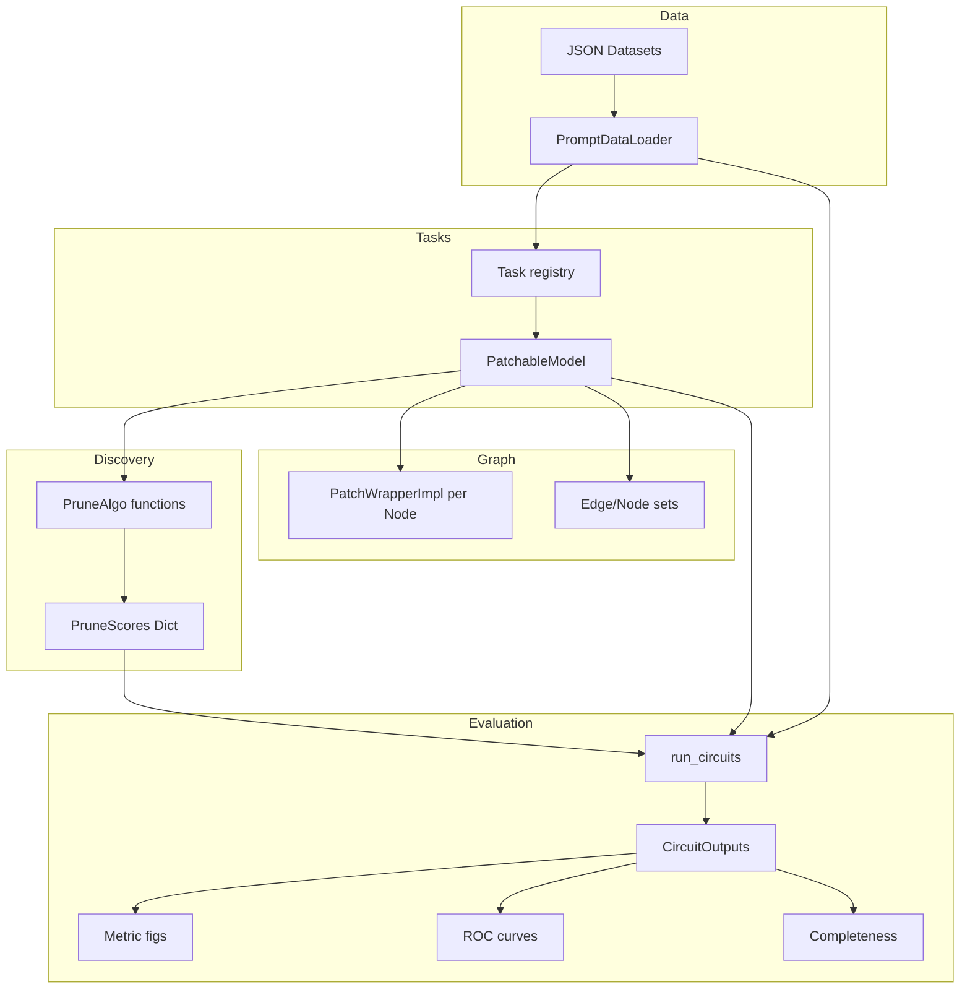
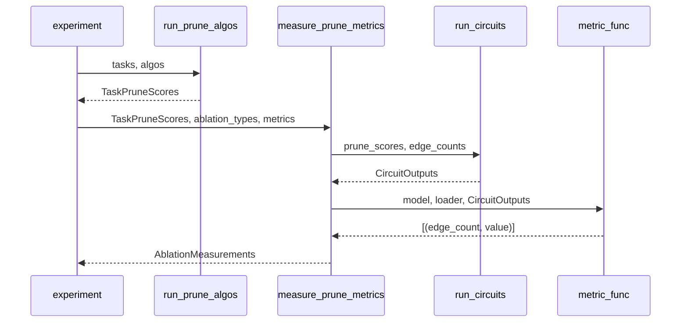

# Codebase Map

> Auto-generated by Cartographer. Last mapped: 2026-05-28T13:27:08Z

## System Overview



## Directory Structure

```
auto_circuit/                  # Core library
  types.py                     # All shared types and constants
  data.py                      # Dataset loading, PromptDataLoader
  tasks.py                     # Task registry (IOI, GT, Docstring …)
  prune.py                     # run_circuits() core loop
  experiment_utils.py          # IOI single-template helper + load_tl_model
  visualize.py                 # Plotly Sankey circuit diagrams

  prune_algos/                 # Circuit discovery algorithms
    prune_algos.py             # PruneAlgo dataclass + registry + runner
    edge_pruning.py            # Edge Pruning (Bhaskar et al. 2024) — THESIS
    disco_gp.py                # DiscoGP (Yu et al. 2025) — THESIS
    ACDC.py                    # ACDC (Conmy et al. 2023)
    subnetwork_probing.py      # Subnetwork / Circuit Probing
    edge_attribution_patching.py  # Reference EAP (slow)
    mask_gradient.py           # Fast gradient EAP + IEG
    circuit_probing.py         # Multi-size circuit probing wrapper
    activation_magnitude.py    # Simple activation baseline
    ground_truth.py            # Oracle ground-truth scores
    random_edges.py            # Random baseline
    parameter_integrated_gradients.py  # Stub — not implemented

  utils/
    patch_wrapper.py           # PatchWrapperImpl — the patching module
    patchable_model.py         # PatchableModel — wraps transformer
    graph_utils.py             # Graph construction, patch_mode ctx, edge counts
    ablation_activations.py    # Computes patch_src_outs tensors
    tensor_ops.py              # Answer scoring, KL div, prune score ops
    gumbel_sigmoid_utils.py    # Gumbel-sigmoid + lambda schedule (DiscoGP)
    l0_utils.py                # Hard-Concrete / L0 utilities (Edge Pruning)
    misc.py                    # Path resolution, cache IO, module access
    custom_tqdm.py             # tqdm wrapper with fixed defaults

  metrics/
    prune_metrics/             # Per-circuit-size performance metrics
      prune_metrics.py         # PruneMetric registry
      measure_prune_metrics.py # Top-level measurement pipeline
      kl_div.py                # KL divergence vs full model
      answer_value.py          # Avg logit/prob of correct answers
      answer_diff.py           # Correct − wrong answer difference
      answer_diff_percent.py   # % of full-model logit diff recovered
      correct_answer_percent.py # Accuracy metric
      prune_metrics_plot.py    # Plotly performance-vs-edge-count figures
      head_heatmap.py          # Layer×head heatmap of aggregated prune scores (NEW)
    completeness_metrics/
      same_under_knockouts.py  # Wang et al. completeness metric
      train_same_under_knockouts.py  # Adversarial knockout search
    official_circuits/
      measure_roc.py           # ROC curve computation
      roc_plot.py              # ROC Plotly figures
      circuits/                # Ground-truth circuit definitions
        ioi_official.py        # IOI circuit (Wang et al. 2023)
        docstring_official.py  # Docstring circuit
        greaterthan_official.py # Greater-Than circuit
        sports_players_official.py  # Sports Players circuit
    area_under_curve.py        # AUC computation + bar charts
    avoid_edges.py             # Constrained circuit probing
    prune_scores_similarity.py # Pairwise circuit overlap heatmaps

  model_utils/
    transformer_lens_utils.py  # TL graph node enumeration
    micro_model_utils.py       # Toy MicroModel for tests
    tracr_model_utils.py       # Compile Tracr programs → HookedTransformer
    sparse_autoencoders/       # SAE-augmented transformer pipeline
    task_projectors/           # Experimental learned projections

experiments/
  circuit_discovery.py         # Main experiment driver (SLURM entry point)
  completeness_experiment.py   # Faithfulness + completeness comparison
  edge_pruning/                # EP-specific validation and reproduction
  ioi/, docstring/, greaterthan/, sports_players/, demos/  # Task-specific scripts

datasets/                      # Prompt JSON files + generators
tests/                         # pytest suite
```

## Module Guide

### types.py — Core type definitions

**Purpose:** Central type definitions used everywhere. Zero imports from within the library (prevents circular deps).

**Key types:**

| Export | Description |
|--------|-------------|
| `PruneScores = Dict[str, Tensor]` | maps `dest_node.module_name` → edge importance tensor |
| `Edge(src, dest, seq_idx)` | single directed graph edge; has `.patch_idx`, `.patch_mask(model)`, `.prune_score(ps)` |
| `SrcNode`, `DestNode` | frozen dataclasses; `SrcNode` has `src_idx` (global), `DestNode` has `min_src_idx` |
| `AblationType` (Enum) | 7 variants: ZERO, RESAMPLE, TOKENWISE_MEAN_*, BATCH_* |
| `PatchType` (Enum) | EDGE_PATCH, TREE_PATCH |
| `MaskFn` | `Optional[Literal["hard_concrete", "sigmoid"]]` |
| `TaskPruneScores` | `Dict[TaskKey, AlgoPruneScores]` |
| `AblationMeasurements` | 4-level nested dict for all evaluation results |
| `PatchWrapper` | abstract nn.Module base — defined here to avoid circular imports |

**Gotchas:**
- `Edge.patch_idx` uses relative indexing: `src.src_idx - dest.min_src_idx`. Wrong `min_src_idx` causes silent bugs.
- Plotly global template is mutated at import time (colorway, font size).

---

### data.py — Dataset infrastructure

**Purpose:** Load JSON prompt files into `PromptDataLoader` instances with clean/corrupt pairs.

**Key types/functions:**

| Export | Description |
|--------|-------------|
| `BatchKey = int` | hash of `(clean.tolist(), corrupt.tolist())` — deterministic batch identity |
| `PromptPairBatch` | batched (clean, corrupt, answers, wrong_answers, batch_diverge_idx) |
| `PromptDataLoader` | extends DataLoader; stores `seq_len`, `diverge_idx`, `kv_cache`, `seq_labels`, `word_idxs` |
| `load_datasets_from_json(model, path, ...)` | → `(train_loader, test_loader)` |

**JSON format:** `{"prompts": [...], "seq_labels": [...], "word_idxs": {...}}`

**Gotchas:**
- `drop_last=True` always — last partial batch silently dropped.
- `tail_divergence=True`: common prefix is KV-cached; prompts are sliced to divergence point.
- Uses `attr.dataclass`, not stdlib `dataclasses`.
- `batch_diverge_idx` is recomputed per batch (can differ from loader's `diverge_idx`).

---

### tasks.py — Benchmark task registry

**Purpose:** Lazy-initialized `Task` objects that bundle model + data loaders + patchable model + ground-truth edges.

**Pre-defined tasks:** IOI, Docstring, Greater-Than, Sports Players (token and component variants), three SAE variants, two Tracr tasks.

**`Task.init_task()` sequence:**
1. Load/cache base HookedTransformer with `use_attn_result=True`, `use_attn_in=True`, `use_split_qkv_input=True`, `use_hook_mlp_in=True`
2. Freeze all params
3. Load/cache datasets
4. `patchable_model()` — injects `PatchWrapperImpl` into model submodules **(mutates model in place)**
5. Compute `true_edges` from task-specific function

**Key constants:** `MODEL_CACHE`, `DATASET_CACHE` — module-level singletons.

**Gotchas:**
- `MODEL_CACHE` is global. Two tasks sharing the same base model share the same already-patched model object — mutation can accumulate.
- `experiment_utils.py` uses `deepcopy(gpt2)` to avoid this; `tasks.py` does not.

---

### prune.py — Core circuit evaluation loop

**Purpose:** `run_circuits()` — given prune scores and edge counts, runs the patched model and returns logit outputs per circuit size.

```python
def run_circuits(
    model, dataloader, test_edge_counts, prune_scores,
    patch_type=EDGE_PATCH, ablation_type=RESAMPLE,
    reverse_clean_corrupt=False, ...
) -> CircuitOutputs  # Dict[int, Dict[BatchKey, Tensor]]
```

**Patch/input selection logic:**

| patch_type | reverse | batch_input | ablation source |
|---|---|---|---|
| EDGE_PATCH | False | corrupt | clean |
| TREE_PATCH | False | clean | corrupt |
| EDGE_PATCH | True | clean | corrupt |
| TREE_PATCH | True | corrupt | clean |

**Gotchas:**
- `patch_edge_count` key = actual edges patched (may differ from `edge_count` due to ties).
- `dest.patch_mask.data` mutated in-place inside `patch_mode`.

---

### utils/patch_wrapper.py — PatchWrapperImpl

**Purpose:** PyTorch module injected at each node's position. Intercepts activations to apply ablation patching.

**Patching formula (dest node):**
```
arg_0 += einsum(mask, patch_src_outs[in_srcs] - curr_src_outs[in_srcs], ...)
```
`mask=0` → keep original; `mask=1` → replace with ablated activation.

**Key attributes:** `patch_mask` (nn.Parameter), `mask_fn` (None/"hard_concrete"/"sigmoid"), `curr_src_outs` / `patch_src_outs` (shared tensors across all wrappers).

**Gotchas:**
- `curr_src_outs` is a **single shared tensor** by reference — all wrappers write slices into the same object.
- `args[0].clone()` always happens, even when not in patch mode (memory cost).

---

### utils/patchable_model.py — PatchableModel

**Purpose:** Container that stores the graph structure (nodes, edges, wrappers) and wraps model forward pass.

**Key attributes:** `nodes`, `srcs`, `dests`, `edges`, `n_edges`, `edge_dict`, `dest_wrappers`, `src_wrappers`, `patch_masks`, `out_slice`.

**Key methods:**
- `new_prune_scores(init_val)` → zero PruneScores matching mask shapes
- `circuit_prune_scores(edges)` → PruneScores with 1.0 for given edges
- `forward()` → injects KV cache by batch size if `kv_caches` is set

**Gotchas:**
- `patch_masks` is a plain `dict`, not `nn.ParameterDict` — these params won't appear in `PatchableModel.parameters()`.
- KV cache lookup by batch size — `KeyError` if mismatched.

---

### utils/graph_utils.py — Graph construction and context managers

**Purpose:** Build the edge graph, inject wrappers into the model, and provide context managers for controlling patch behavior.

**Key functions:**

| Function | Description |
|----------|-------------|
| `patchable_model(model, factorized, ...)` | End-to-end: builds graph + injects wrappers |
| `graph_edges(model, factorized, ...)` | Returns nodes/edges/edge_dict |
| `make_model_patchable(model, ...)` | Injects PatchWrapperImpl at each node's module_name |
| `patch_mode(model, patch_src_outs)` | ctx mgr: activates patching, shares src_out tensor |
| `train_mask_mode(model)` | ctx mgr: enables grad on patch_mask params only |
| `mask_fn_mode(model, mask_fn)` | ctx mgr: activates HC/sigmoid in forward |
| `set_all_masks(model, val)` | Sets all patch_masks to scalar val |
| `edge_counts_util(...)` | Converts TestEdges spec → `List[int]` |

**Gotchas:**
- `patchable_model()` **permanently modifies the model**. Call `deepcopy` first if you need the original.
- `src_idxs_slice` must be contiguous — asserted.
- `edge_counts_util` auto-selects LOGARITHMIC for large graphs, GROUPS when scores have few unique values.

---

### utils/ablation_activations.py — Ablation tensor computation

**Purpose:** Compute `patch_src_outs` — the tensor of ablated activations for each source node.

```python
def batch_src_ablations(model, dataloader, ablation_type, clean_corrupt) -> Dict[BatchKey, Tensor]
# Returns: Dict[batch_key → Tensor[n_srcs, batch, seq, d_model]]
```

**AblationType mechanics:**
- `ZERO` → zeros
- `RESAMPLE` → corrupt input activations
- `TOKENWISE_MEAN_*` → mean over batch, per token position
- `BATCH_ALL_TOK_MEAN` → mean over batch AND sequence

---

### utils/tensor_ops.py — Tensor utilities

**Key functions:**

| Function | Description |
|----------|-------------|
| `sample_hard_concrete(log_alpha, batch_size)` | Stochastic HC sample in [0,1] |
| `batch_avg_answer_diff(vals, batch)` | Mean (correct − wrong) logit difference |
| `multibatch_kl_div(log_p, log_q)` | KL(p‖q) summed, normalized per sample |
| `desc_prune_scores(ps)` | Flat sorted descending tensor (uses abs) |
| `prune_scores_threshold(ps, n)` | n-th highest score value |

**HC constants:** `left=-0.1, right=1.1, temp=2/3` (same as `l0_utils` but defined independently).

---

### utils/gumbel_sigmoid_utils.py — DiscoGP utilities

**Key functions:**
- `gumbel_sigmoid(logits, gs_temp, hard)` — straight-through estimator when `hard=True`; noise = difference of two Gumbel samples.
- `schedule_epoch_lambda(epoch, λ₀, max_times, min_times, n_epoch_warmup, n_epoch_cooldown)` — ramp-up → constant → cool-down schedule for sparsity coefficient.

---

### utils/l0_utils.py — Edge Pruning L0 utilities

**Key exports:**
- `FACTOR=0.8`, `TEMPERATURE=2/3`, `LIMIT_LEFT=-0.1`, `LIMIT_RIGHT=1.1`
- `deterministic_z(log_alpha)` — eval-time binary mask via expected zero-count rounding
- `cdf_stretched_concrete(x, log_alpha)` — CDF of stretched-concrete distribution
- `get_linear_schedule_with_warmup(optimizer, warmup, total)` — warmup then linear decay

---

## Pruning Algorithms

### Algorithm Function Signature Contract

All prune algo functions must implement:
```python
def algo_prune_scores(
    model: PatchableModel,
    dataloader: PromptDataLoader,
    official_edges: Optional[Set[Edge]],
    **kwargs,
) -> PruneScores
```

### Score Conventions

| Algorithm | Score range | Sign | Convention |
|---|---|---|---|
| Edge Pruning | (0, 1) | positive | p_keep = 1 − σ(log_alpha/T·F) |
| DiscoGP | (0, 1) | positive | σ(edge_logit) |
| mask_gradient / EAP | unbounded | signed | raw gradient (downstream uses abs) |
| ACDC | (0, ∞) | positive | min tao at which edge was removed |
| Ground Truth | {0, 1} | positive | 1 if in official circuit |

### prune_algos/edge_pruning.py — Edge Pruning (THESIS)

**Paper:** Bhaskar et al., NeurIPS 2024

**Algorithm (8 steps):**
1. Cache clean logits (inference_mode)
2. Compute `patch_src_outs` via RESAMPLE ablation
3. Create `edge_log_alphas` (nn.Parameter per dest wrapper) + `node_log_alphas` (per src node)
4. Create Lagrangian λ₁, λ₂ parameters for edges and nodes; frozen at 0 when disabled
5. AdamW with 2–4 param groups (edge params minimize, λ params maximize)
6. Training: HC sampling → compose edge × node masks → temp-swap `wrapper.patch_mask` → forward → KL loss + Lagrangian reg → backward
7. Optional Plotly HTML training graph
8. Extract: `p_keep = 1 − σ(log_alpha/T·F)` × node_p_keep

**Known structural difference from original:** Masks pre-composed before patching (vs sequential through forward pass in original). Node + edge masks compose as `effective = 1 − (1 − z_edge) × (1 − z_node)`.

**Multi-fidelity HPO hooks:** `eval_callback` and `eval_every` — returning `True` from callback prunes the trial early.

**Score extraction:** Continuous `_soft_mask = σ(log_alpha / T × F)`, then `prune_score = 1 − soft_mask` (high score = important). Changed from binary `deterministic_z` to give downstream threshold sweep a smooth ranking.

**Key hyperparams (registered defaults):** `lr=0.8`, `lambda_lr=0.8`, `steps=3000`, `target_edge_sparsity=1.1`, `target_node_sparsity=0.72`, `sparsity_warmup_steps=2500`, `use_node_masks=True`, `disable_node_loss=True` (in registered variant), `init_log_alpha=10.0`.

**`disable_node_loss=True` in `EDGE_PRUNING_PRUNE_ALGO`:** Node masks still applied but their Lagrangian multipliers are frozen at 0 — matches original paper's `--disable_node_loss` mode for IOI.

---

### prune_algos/disco_gp.py — DiscoGP (THESIS)

**Paper:** Yu et al., EMNLP 2025

**Two-phase algorithm:**

**Phase 1 — Weight Masks** (`use_weight_masks=True`):
- Per-element logit params for linear weights (skips `emb`, `ln`, `edge`, `unembed` in name)
- Trains with `gumbel_sigmoid` + scheduled `lambda_sparse`
- Faithfulness loss = CE against clean argmax (`argmax_ce` mode) or 2-class margin CE (`answer_margin_ce`)
- Optional completeness loss = CE against uniform with reversed masks (disabled by default: `w_lambda_complete_init=0.0`)
- After training: bake deterministic masks (`logit > 0`)

**Phase 2 — Edge Masks** (`use_edge_masks=True`):
- Zero ablation source activations
- Per-module edge logit params
- Same schedule + faithfulness + completeness losses (completeness active by default: `e_lambda_complete_init=1.0`)
- Convention: DiscoGP mask=1 → keep; AC mask=1 → ablate → `AC_mask = 1 − disco_mask`
- For the completeness reversed pass: `AC_mask = disco_mask` (double-negation — non-obvious)

**Loss modes (`loss_mode` parameter):**

| Mode | Supervision | Faith loss | Completeness loss |
|---|---|---|---|
| `"argmax_ce"` (default) | Cached clean argmax | Full-vocab CE vs clean argmax | CE vs uniform 1/V |
| `"answer_margin_ce"` | `batch.answers` / `batch.wrong_answers` | `softplus(mean_wrong − mean_correct)` | 2-class CE vs `[0.5, 0.5]` on (correct, wrong) pair |

**Multi-fidelity HPO hooks:** `eval_callback` and `eval_every` parameters are wired into Phase 2 only; returning `True` from the callback prunes the trial early.

**Output:** `sigmoid(edge_logit)` — higher = more important.

**Original weights restored before return.**

**Design choices vs paper:**
- Weight pruning is optional (`use_weight_masks` flag) — intentional thesis design
- No QKV split (uses AutoCircuit's single-node-per-head factorization)
- `w_n_epoch_warmup = 500` equals `w_train_epochs = 500` — sparsity pressure ramps linearly with no plateau

**Registered algo variants:**

| Key | Weight masks | Edge masks | hard | loss_mode | completeness |
|---|---|---|---|---|---|
| `DISCO_GP_PRUNE_ALGO` (`"DiscoGP (joint)"`) | ✓ | ✓ | True (default) | `argmax_ce` | Phase 2 ON |
| `DISCO_GP_EDGE_ONLY_PRUNE_ALGO` (`"DiscoGP-E"`) | ✗ | ✓ | True (explicit) | `argmax_ce` | OFF (`e_lambda_complete_init=0`) |
| `DISCO_GP_EDGE_ONLY_PAPER_PRUNE_ALGO` (`"DiscoGP"`) | ✗ | ✓ | True (explicit) | `answer_margin_ce` | ON (`e_lambda_complete_init=1`) |

The paper-faithful edge-only variant carries the plain display name `"DiscoGP"` (it is the form the thesis reports); the joint weight+edge variant is labelled `"DiscoGP (joint)"`. Algo *keys* and the `run_cell.py` CLI slugs (`discogp-ep`, `discogp`) are unchanged, so cached `PruneScores` still resolve.

The previous `DISCO_GP_EDGE_ONLY_HARD_PRUNE_ALGO` (which had a bug where `hard` was not passed) has been removed and replaced by the two new edge-only variants above — both explicitly pass `hard=True`.

---

### prune_algos/ACDC.py — ACDC

**Algorithm:** Greedy edge removal. For each tao in `tao_bases × 10^tao_exps`, iterate edges sorted by layer (deepest first). Patch each edge; if faithfulness degrades by < tao, keep it patched. Score = min tao at which edge was permanently removed; circuit edges get `inf`.

**Gotchas:** Only uses first batch. Runs sweep over all tao values.

---

### prune_algos/subnetwork_probing.py — Subnetwork Probing

**Algorithm:** Gradient descent on patch_mask parameters (Hard Concrete). Ablation: `TOKENWISE_MEAN_CORRUPT`. Regularizer: `n_mask / n_edges`. 6 faithfulness targets supported.

**Used as a building block by:** `circuit_probing.py`, `experiment_utils.py`.

---

### prune_algos/mask_gradient.py — Fast EAP / IEG

**Algorithm:** Computes `∂loss/∂patch_mask` at `mask_val=0` (EAP) or integrated over 0→1 (IEG). 4 `grad_function` variants × 3 `answer_function` variants.

---

## Metrics Pipeline



### Metric Registry (prune_metrics.py)

| Metric key | Description | Lower=better |
|---|---|---|
| `CLEAN_KL_DIV_METRIC` | KL from full model (faithfulness) | ✓ |
| `ANSWER_PROB_METRIC` | Mean correct-answer probability | ✗ |
| `CORRECT_ANSWER_PERCENT_METRIC` | Accuracy (correct highest logit) | ✗ |
| `LOGIT_DIFF_PERCENT_METRIC` | % of logit diff recovered (IOI) | ✗ |
| `CORRECT_ANSWER_GREATER_THAN_INCORRECT_PERCENT_METRIC` | correct > all wrong | ✗ |

### ROC curves (measure_roc.py, roc_plot.py)

Sweeps edge counts, computes TPR/FPR vs official circuit edges. Uses `.abs()` on scores.

`roc_plot.py` uses manual `paper`-coordinate subplot title annotations (not Plotly's built-in `subplot_titles`, which clips long task names). Single-point measurements switch to `mode="markers+text"` to be visible. Variable-width lines controlled by `variable_width=True` flag.

### Head Importance Heatmap (prune_metrics/head_heatmap.py) — NEW

Aggregates edge-level `PruneScores` by attention head and renders a layer × head heatmap styled after Figure 3(b) of the IOI paper.

**Key exports:**

| Function | Signature | Returns |
|---|---|---|
| `aggregate_scores_by_head` | `(PruneScores, PatchableModel, agg="sum")` | `Tensor[n_layers, n_heads]` |
| `head_importance_heatmap` | `(PruneScores, PatchableModel, algo_name, task_name, agg="sum", output_dir, file_formats)` | `go.Figure` |

**Aggregation modes:** `"sum"` (default, favours well-connected heads), `"max"` (peak single-edge score), `"mean"` (average over incoming edges).

**Layer remapping:** `layer_idx = (e.dest.layer - 1) // 2` — translates AutoCircuit's odd-integer internal layer numbering (1, 3, 5 … 23 for GPT-2 Small) to transformer layer indices (0, 1, 2 … 11). Grid size inferred dynamically from max observed values.

**Visual style:** `RdBu` diverging colorscale, `zmid=0`, y-axis reversed (layer 0 at top).

**Save path:** `{output_dir}/{task_slug}/{algo_slug}/head_importance_{aggregation}.{ext}`. PNG requires `kaleido`; pass `file_formats=("html",)` to avoid that dependency.

### Completeness (same_under_knockouts.py)

Wang et al. (2022) metric: measures whether knocking out circuit-internal edges affects the circuit and full model equally. Trained adversarially by `train_same_under_knockouts.py`.

---

## Official Circuits (Ground Truth)

| Circuit file | Model | Task | Notes |
|---|---|---|---|
| `ioi_official.py` | GPT-2 Small | IOI (Wang et al. 2023) | asserts `separate_qkv=True` |
| `docstring_official.py` | Attn_Only_4L512W | Docstring | asserts specific model name |
| `greaterthan_official.py` | GPT-2 Small | Greater-Than | no token position filtering |
| `sports_players_official.py` | pythia-2.8b-deduped | Sports Players | asserts `separate_qkv=False` |

---

## Model Utilities

### transformer_lens_utils.py

Provides `factorized_src_nodes(model)`, `factorized_dest_nodes(model, separate_qkv)`, and `simple_graph_nodes(model)` for `HookedTransformer` instances. These are the primary extension points for adding new model types.

### micro_model_utils.py

`MicroModel` — a deterministic 2-layer toy transformer with fixed weights `[[1,2],[3,4]]`. Used extensively in tests to verify exact numerical outputs. Do not change the weights — test assertions are hardcoded against them.

### tracr_model_utils.py

Compiles Tracr programs (reverse, xproportion) into `HookedTransformer` by reshaping Jax parameter arrays. Uses `strict=False` in state dict loading.

### sparse_autoencoders/

`SparseAutoencoder` wraps a `HookPoint`, intercepts activations, and makes individual latents patchable as circuit nodes. `AutoencoderTransformer` wraps a full model with one SAE per MLP layer. Pretrained SAEs downloaded from Azure (GPT-2) or baulab.us (Pythia).

### task_projectors/

Experimental learned linear projection modules. **Not integrated with circuit discovery** — `factorized_src_nodes`/`factorized_dest_nodes` are fully commented out. Do not rely on this for thesis work.

---

## Experiments

### experiments/circuit_discovery.py (main entry point)

The primary experiment script run via `run.sh` or `srun`. Currently configured for IOI component circuit.

**Active PRUNE_ALGOS (as of 2026-05-28):**
```python
[GROUND_TRUTH_PRUNE_ALGO, RANDOM_PRUNE_ALGO, EDGE_ATTR_PATCH_PRUNE_ALGO,
 DISCO_GP_EDGE_ONLY_PRUNE_ALGO, DISCO_GP_PRUNE_ALGO, DISCO_GP_EDGE_ONLY_PAPER_PRUNE_ALGO]
# ACDC_PRUNE_ALGO and EDGE_PRUNING_PRUNE_ALGO are commented out
```

**Pipeline:**
1. `run_prune_algos(TASKS, PRUNE_ALGOS)` → `TaskPruneScores`
2. Optional cache save/load (`.prune_scores_cache/*.pkl`)
3. dtype cast to `float32`
4. Circuit graph visualisation (Sports Players only — silently skips IOI)
5. Prune score similarity heatmap at `[10, 100, 1000, 10000]` edges with `ground_truths=True`
6. Optional completeness measurement (disabled by default)
7. ROC curves
8. `measure_prune_metrics` at RESAMPLE, TOKENWISE_MEAN_CORRUPT, ZERO ablation types
9. Save all figures as PDFs under `figures/circuit_discovery/{YYYY-MM-DD_HH-MM-SS}/`

**Gotcha:** Circuit graph drawing block filters to `SPORTS_PLAYERS_TOKEN_CIRCUIT_TASK` only — no graphs drawn for IOI even though IOI is the active task. `save_prune_metric_measurements=False` despite compute=True.

### experiments/completeness_experiment.py

CLI-driven (has `if __name__ == "__main__"` guard). Runs discovery + adversarial knockout training + completeness + faithfulness. Output to `figures/completeness_experiment/`.

### experiments/edge_pruning/

- `reproduce_ep_results.py` — sweeps 10 sparsity targets to trace faithfulness-sparsity curve matching Bhaskar et al. results.
- `validate_edge_pruning.py` — benchmarks EP vs EAP, SP, Random on IOI. Includes top-100 edge ranking saved to `top_edges.json`, prune score similarity at `[10, 50, 100, 500]` edges, and a per-algorithm sparsity summary printed to stdout.

---

## Tests

**Framework:** pytest with `scope="session"` fixtures in `conftest.py`.

**Key fixtures:** `gpt2` (full GPT-2), `mini_tl_transformer` (2L-4d toy TL model), `micro_model` (deterministic `MicroModel`), `micro_dataloader`.

**Slow tests:** Marked `@pytest.mark.slow`, skipped unless `--runslow` passed.

| Test file | What it covers |
|---|---|
| `test_prune.py` | Exact numerical correctness of circuit patching on MicroModel |
| `prune_algos/test_edge_pruning_components.py` | Tier A of the EP port-fidelity study: 25 bitwise tests of hard-concrete L0, the Lagrangian, the sparsity schedule and KL, driven against the reference's own code (skips if `third_party/edge_pruning` is absent) |
| `prune_algos/test_edge_pruning_equivalence.py` | Tier B: edge bijection + forward equivalence under masking vs a measured numerical floor (`--runslow`, one GPU) |
| `test_experiment_utils.py` | IOI faithfulness regression vs hardcoded reference values |
| `utils/test_graph_utils.py` | `edge_counts_util` edge count specs |
| `utils/test_tensor_ops.py` | Answer scoring and KL div functions |
| `utils/test_ablation_activations.py` | `src_ablations` for all ablation types |
| `model_utils/test_unfactorized_edges.py` | Factorized vs unfactorized equivalence |

---

## Conventions

### Mask convention (critical)
`patch_mask = 0` → **keep** original activation (edge in circuit)
`patch_mask = 1` → **ablate** (replace with corrupted activation, edge removed)

DiscoGP uses the opposite internally (mask=1 means keep) and converts with `AC_mask = 1 − disco_mask`.

### Module naming
`dest_node.module_name` is the Python attribute path in the model (e.g., `blocks.0.hook_attn_out`). `set_module_by_name` uses `setattr` to inject wrappers at these paths.

### Prune score convention
Higher absolute value = more important = edge is in circuit. Downstream code always uses `.abs()` before thresholding, so negative and positive scores are both handled.

### Token circuit vs component circuit
`token_circuit=True` → separate `Edge` per token position; `False` → one edge across all positions.

---

## Gotchas (Cross-Cutting)

1. **Global `MODEL_CACHE` mutation:** `tasks.py` caches patched models. Two tasks sharing a base model share the same object. Always `deepcopy` before patching for isolated experiments (as `experiment_utils.py` does).

2. **`autoencoder_training.py` / `task_projectors/task_projector_training.py` execute on import** — these are scripts, not modules. Do not import them.

3. **`DISCO_GP_EDGE_ONLY_HARD_PRUNE_ALGO` removed** — replaced by `DISCO_GP_EDGE_ONLY_PRUNE_ALGO` and `DISCO_GP_EDGE_ONLY_PAPER_PRUNE_ALGO`, both of which explicitly pass `hard=True`.

4. **`parameter_integrated_gradients.py` is entirely a stub** — commented out; `PIG` algos will error.

5. **`avoid_edges.py` has a type bug** — iterates `PruneScores` dict keys (strings) as if they were `Edge` objects for sorting.

6. **Dockerfile deletes its own working directory** — the final `rm -rf` removes the venv; likely a bug.

7. **`_post_init` in `PruneMetric`** — not `__post_init__`, so validation never runs.

8. **`log_alpha` sign convention in EP:** Stored as `-init_log_alpha` so HC samples start near 0 (= keep). A positive log_alpha → edge likely ablated.

---

## Navigation Guide

**To add a new algorithm:**
1. Implement `my_algo_prune_scores(model, dataloader, official_edges, ...) -> PruneScores` in a new file under `auto_circuit/prune_algos/`
2. Register a `PruneAlgo` instance in `prune_algos/prune_algos.py` and add to `PRUNE_ALGOS` list
3. Import and add to `experiments/circuit_discovery.py`'s `PRUNE_ALGOS`

**To add a new benchmark task:**
1. Add prompt JSON to `datasets/`
2. Define `true_edges` function in `metrics/official_circuits/circuits/`
3. Add `Task(...)` instance and entry in `TASK_DICT` in `tasks.py`

**To run experiments:**
- Interactive: `srun -w nelson --gres=gpu:1 python experiments/circuit_discovery.py` (avoid bob/minerva — 40GB OOMs with DiscoGP paper loss)
- Batch: `sbatch run.sh`
- Logs: `/storage/ukp/work/akdag/thesis/auto-circuit/logs/`
- Figures: `figures/circuit_discovery/{YYYY-MM-DD_HH-MM-SS}/`

**To generate a head importance heatmap:**
```python
from auto_circuit.metrics.prune_metrics.head_heatmap import head_importance_heatmap
fig = head_importance_heatmap(prune_scores, model, algo_name="EP", task_name="IOI",
                              aggregation="sum", output_dir=Path("figures/"))
```

**To validate an algorithm's correctness:**
- Add smoke test to `tests/` verifying mathematical properties
- Compare ROC against ground truth in `circuit_discovery.py`
- Check training curves in `{algo}_train_graph.html` generated at root level

**To extend to a new model type:**
1. Implement `factorized_src_nodes(model)`, `factorized_dest_nodes(model, separate_qkv)`, `simple_graph_nodes(model)` analogous to `transformer_lens_utils.py`
2. Add dispatch branch in `graph_utils.graph_edges()`
