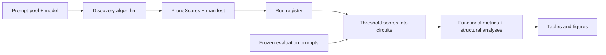

# Architecture

The repository has three layers: the reusable AutoCircuit library, thesis experiment runners, and an immutable selected artifact bundle. [Reproduction commands](reproduction.md) orchestrate those layers through SLURM.

| Path | Purpose |
| --- | --- |
| `auto_circuit/` | Models, prompt loaders, patching, pruning algorithms, metrics, visualization |
| `experiments/` | Thesis discovery, cache selection, evaluation, analysis, exporters, and validation |
| `hpo/` | Historical exploratory nested-CV search and refit tools |
| `datasets/` | Original prompt pools and frozen evaluation inputs |
| `artifacts/final/` | Selected scores, manifests, evidence, hashes, and registry |
| `scripts/` | User entry point, setup, and SLURM job wrappers |
| `tests/` | Library and experiment protocol tests |
| `results/` | Ignored generated outputs for each run |

## Discovery and evaluation

`load_tl_model` loads a TransformerLens model, and `patchable_model` wraps its computational graph. Each discovery algorithm has the interface `func(model, dataloader, official_edges) -> PruneScores`. `PruneScores` maps destination module names to tensors containing one score per incoming edge. The algorithm returns scores once; `run_circuits` later thresholds their magnitudes to construct nested circuits at different edge budgets.

The thesis adds [Edge Pruning](../auto_circuit/prune_algos/edge_pruning.py) and [DiscoGP](../auto_circuit/prune_algos/disco_gp.py). Edge Pruning learns Hard-Concrete masks with Lagrangian sparsity constraints and optional source-node masks. DiscoGP learns Gumbel-sigmoid masks. The thesis reports its edge-only answer-margin formulation. Other library variants remain registered and usable outside that comparison. The full registry lives in [prune_algos.py](../auto_circuit/prune_algos/prune_algos.py).

## Patching

`PatchableModel` exposes the source nodes, destination wrappers, edges, and masks. A destination `PatchWrapperImpl` uses `patch_mask=0` to preserve an edge activation and `patch_mask=1` to replace it with an ablated source activation. The `patch_mode` context manager supplies the replacement activations during a masked forward pass. Discovery scores and patch masks therefore have different conventions; the circuit runner performs their conversion.

Zero, paired resample, and corrupt-tokenwise-mean ablations are shared evaluation choices. The patching machinery also retains upstream token-specific graphs and cached-prefix support. See [the patching internals guide](<guides/4)_How_it_Works.md>).

## Protocol and provenance

Discovery identity includes task, method, ablation, seeds, data budget, objective, and split protocol. Evaluation adds the actual input and answer identities, tokenizer/model identity, and evaluation settings. A registry selects explicit files rather than searching arbitrary historical cache directories. Score and manifest hashes protect immutable inputs; output manifests connect analyses and exports to their selected sources.

The main comparison runs IOI and Greater-Than on GPT-2 Small. Docstring uses `attn-only-4l` and its `NeelNanda/gpt-neox-tokenizer-digits` tokenizer; its appendix analysis must not be pooled into main-task claims. Validation against the original EP and DiscoGP implementations has its own frozen IOI inputs, reference revisions, and statistics. See [artifacts](artifacts.md) and [evaluation protocols](evaluation_protocol.md).
